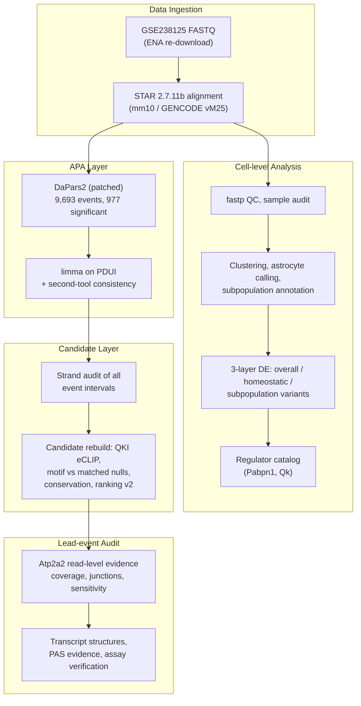
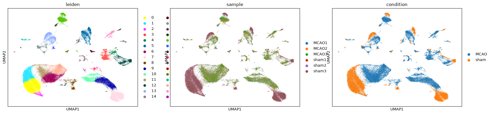
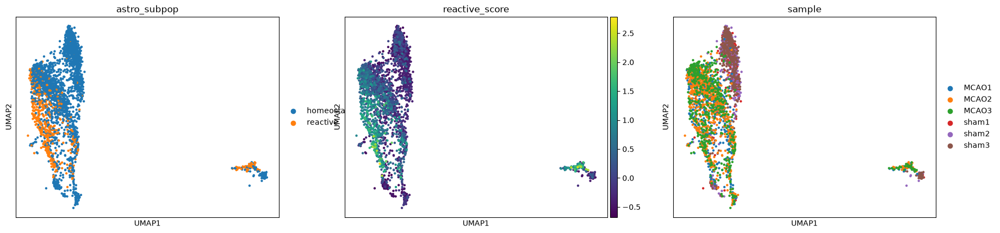
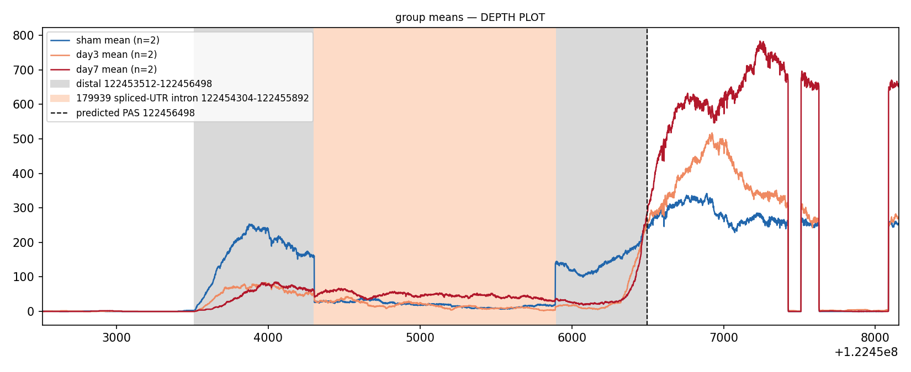

# Stroke-APA

**Computational analysis of alternative polyadenylation and 3′UTR isoform shifts in mouse cortical astrocytes after ischemic stroke**

[](https://github.com/Tiannn0512/Stroke-APA-/releases/tag/v2026-09-25-phase1-followup)
[](LICENSE)
[](https://www.python.org/)
[](data/DATA_MANIFEST.md)

Stroke-APA is a computational study of ischemic-stroke effects on astrocytic mRNA alternative polyadenylation (APA) and 3′UTR isoform composition, built entirely on the public FACS-sorted astrocyte stroke time course GSE238125 (mouse cortex, MCAO vs sham). Of 9,693 APA events quantified, 977 changed significantly after stroke (FDR < 0.05), with widespread 3′UTR shortening. The lead event, **Atp2a2** (SERCA2), was audited down to the single-isoform level: reads spanning the long isoform's splice junction dropped ~96% after stroke while the pre-mRNA control region stayed flat, and the DaPars2-predicted proximal site was re-anchored to the annotated end with independent 3′-end database support. All findings are candidate observations from one public cohort of n = 2 per group with a shared sham.

> **Code availability.** Three tagged snapshots exist.
> [`v2026-09-23`](https://github.com/Tiannn0512/Stroke-APA-/releases/tag/v2026-09-23) carries the four deliverable archives of the discovery and reanalysis phases.
> [`v2026-09-24-gate1-reaudit`](https://github.com/Tiannn0512/Stroke-APA-/releases/tag/v2026-09-24-gate1-reaudit) is the state after the first re-audit round (CIGAR and FASTA parsing fixes, transcript structures, IGV evidence).
> [`v2026-09-25-phase1-followup`](https://github.com/Tiannn0512/Stroke-APA-/releases/tag/v2026-09-25-phase1-followup) is the current state, after a second re-audit round that fixed five more assay-design defects and re-anchored the proximal PAS. What changed and why is recorded in the per-phase reports under `docs/`.

---

## Table of Contents

- [Introduction](#introduction)
- [Pipeline](#pipeline)
- [Phase 1: Discovery Analysis](#phase-1-discovery-analysis)
- [Phase 2: APA Discovery](#phase-2-apa-discovery)
- [Phase 3: Strand Audit and Candidate Rebuild](#phase-3-strand-audit-and-candidate-rebuild)
- [Phase 4: Atp2a2 Lead Event](#phase-4-atp2a2-lead-event)
- [Public Cohort Re-checks](#public-cohort-re-checks)
- [Repository Structure](#repository-structure)
- [Installation](#installation)
- [Usage](#usage)
- [Citation](#citation)
- [Acknowledgements](#acknowledgements)
- [Data Availability](#data-availability)
- [License](#license)

---

## Introduction

Alternative polyadenylation (APA) replaces a long 3′UTR with a shorter one without changing the protein, which removes miRNA and RBP binding sites and can alter mRNA localization and stability. Two observations motivate asking about APA after stroke:

- **Astrocytes are the stroke-responsive glial cell type**, and their transcriptome shifts over days after MCAO, but isoform-level changes are rarely examined — gene-level differential expression dominates the literature
- **Astrocyte perisynaptic processes (PAPs) carry a local transcriptome** whose composition depends on 3′UTR length, so a stroke-induced APA shift could change which message versions reach the processes, not just how much of each gene is expressed

This repository analyzes the question end to end from public data: cell-level QC and astrocyte calling, genome-wide APA quantification, a strand-corrected candidate layer with regulator evidence, and a single-event deep audit of Atp2a2 that resolves the change to named isoforms with verified detection anchors.

### Key Contributions

1. **Genome-wide APA quantification** in FACS-sorted stroke astrocytes: 9,693 events, 977 significant, widespread 3′UTR shortening, with Pabpn1 and Qk as top regulator candidates
2. **A strand audit that caught a systematic error**: the first pass defined the lost distal segments on the wrong strand for the negative-strand genes; the candidate layer (QKI eCLIP, motif enrichment, conservation, ranking) was rebuilt on corrected coordinates
3. **Isoform-level resolution of the lead event**: the long Atp2a2 isoform has a split 3′UTR (2,053 bp interrupted by a 1,588 bp intron), which provides a unique junction and a unique 447 bp segment; junction reads drop ~96% after stroke while pre-mRNA indicators stay flat, separating isoform-composition change from transcriptional collapse
4. **A re-anchored proximal PAS with external support**: the DaPars2-predicted proximal site has no poly(A) signal and noise-level 3′-end support; the annotated end chr5:122,456,339 carries a PolyASite cluster (signal 48.1, 7 datasets, AATAAA at −31)
5. **A machine-verified assay set for the three isoforms** (14 oligos, exact and ≤1-mismatch scanned against transcriptome, locus, and the Gm30970 processed pseudogene), delivered in silico

## Pipeline



### Stage list

1. **Data ingestion:** ENA re-download of GSE238125 FASTQ, md5 checks, STAR alignment against mm10/GENCODE vM25
2. **Cell level:** fastp QC, clustering with astrocyte calling and subpopulation annotation, three-layer differential expression, regulator catalog
3. **APA layer:** DaPars2 (patched: empty-coverage events return NA) over 9,693 events; limma statistics with a second-tool consistency check
4. **Candidate layer:** strand audit of every event interval, then QKI eCLIP intersection, motif enrichment against matched nulls, conservation, and strand-corrected ranking
5. **Lead-event audit:** read-level evidence with pre-mRNA controls and junction-removal sensitivity, transcript structure definitions, PAS re-anchoring, in-silico assay verification, public-cohort re-checks

Each stage's scripts and frozen parameters are listed by `python run_all.py`.

---

## Phase 1: Discovery Analysis

**Dataset:** GSE238125, FACS-sorted mouse cortical astrocytes after MCAO (sham, day 1, day 3, day 7, day 21, day 60; n = 2 per time point). This project analyzes sham / day 3 / day 7; the sham group is shared across time points.

### QC and cell calling

Sample audit and per-sample QC (`results/v5_1/p1_qc_summary.tsv`); clustering with astrocyte calling and subpopulation annotation (`p1_all_cells_clusters.tsv`, figures below).





### Differential expression

Three layers: overall astrocytes, homeostatic astrocytes, and subpopulation variants with doublet/ambient-RNA sensitivity runs (`p1_DE_overall_astro.tsv`, `p1_DE_homeostatic_astro.tsv`, `p1_07_variant_DE_*.tsv`). A regulator screen over the DE results nominates **Pabpn1** and **Qk** (STAR-family / poly(A)-binding regulators) as candidate APA trans-factors (`p1_regulator_catalog.tsv`).

> **Cohort note.** n = 2 per group with a shared sham: the time points are not independent replications of each other, and no per-cell information survives FACS sorting. Everything downstream is one evidence line from one cohort.

---

## Phase 2: APA Discovery

DaPars2 (patched source in `tools/DaPars2_patched/`, empty-coverage events return NA instead of 0) quantified 9,693 APA events across the six samples.

| Layer | Result |
|--------|--------|
| Events quantified | 9,693 |
| Significant (FDR < 0.05) | **977** |
| Direction | widespread 3′UTR shortening after stroke |
| Statistics | limma on PDUI (`p2_sap_layer2_omnibus.tsv`) |
| Second tool | sign consistency on top-40 events (`p2_second_tool_consistency.tsv`) |
| QC | sample-level, stratified, PCA, correlation (`p2_full_qc_*.tsv`) |

Top events with per-event evidence: `results/v5_1/p2_gate_g2_top_events.tsv`.

---

## Phase 3: Strand Audit and Candidate Rebuild

The first pass defined each event's "lost distal segment" on the wrong strand for negative-strand genes — for a minus-strand gene the distal 3′UTR lies at *lower* genomic coordinates. Every event interval was re-derived strand-aware (`results/reanalysis/01_strand_audit/`), and the candidate layer was rebuilt:

| Evidence layer | Content | File |
|----------------|---------|------|
| QKI eCLIP | peak intersections per event; Atp2a2 distal peak at chr5:122,454,200–250, FDR 1.04e-5 | `qki_per_event_summary.tsv` |
| Motif | enrichment against length- and GC-matched null segments | `motif_family_enrichment.tsv` |
| Conservation | phastCons over distal segments | `distal_conservation.tsv` |
| Ranking | strand-corrected candidate ranking | `candidate_ranking_v2.tsv` |

The audit also recorded which events changed class or QKI status between passes (`events_changed_class.tsv`, `events_changed_qki_status.tsv`) rather than silently overwriting the first pass.

---

## Phase 4: Atp2a2 Lead Event

**Event 6953, chr5:122,453,512–122,456,498, negative strand** (mm10, BED 0-based). Atp2a2 encodes SERCA2, the endoplasmic-reticulum Ca²⁺ pump.

### Isoform structure

GENCODE vM25 annotates three main transcripts in the event window:

| Isoform | Transcript | 3′UTR | Unique identifier |
|---------|------------|-------|-------------------|
| Long (L) | ENSMUST00000179939.7 | 2,053 bp, **split across a 1,588 bp intron** (122454304–122455892) | unique junction + unique 447 bp segment (122455892–122456339) |
| Short (S) | ENSMUST00000177974.7 | 780 bp, terminal exon | unique junction (donor 122457302 → acceptor 122454304) |
| Medium (M) | ENSMUST00000031423.9 | 814 bp, penultimate exon | none; identifiable only by its 3′ end |

Two minor transcripts (698 / 615 bp, 3′ ends outside the window) are also annotated. A processed pseudogene, **Gm30970** (ENSMUST00000227710.1, 363 bp on chr14), is a near-perfect copy of L-mRNA positions 3157–3519 and constrains assay design.

### Read-level evidence (n = 2 per group)

| Metric | Sham | Day 3 | Day 7 |
|--------|------|-------|-------|
| DaPars2 PDUI (rep 1 / rep 2) | 0.19 / 0.20 | 0.08 / 0.06 | 0.09 / 0.09 |
| Distal/shared coverage ratio | 0.334 / 0.271 | 0.086 / 0.084 | 0.086 / 0.085 |
| L-junction reads (rep 1 / rep 2) | 96 / 136 | 4 / 11 | 2 / 7 |
| S-junction reads | 13 / 18 | 14 / 10 | 8 / 15 |
| Pre-mRNA indicator (intron coverage, normalized) | 0.067 / 0.071 | 0.085 / 0.081 | 0.085 / 0.081 |

- Salmon isoform proportions move in the same direction at all five time points
- Removing every read that carries the L-junction leaves the sham–stroke coverage gap largely intact (sham 0.334→0.311, 0.271→0.251; stroke essentially unchanged)
- The pre-mRNA indicator region (the spliced-UTR intron) does **not** collapse, which separates an isoform-composition change from a transcriptional shutdown



> **Inference caveat.** PDUI, coverage ratios, junction counts, and Salmon proportions all come from the same six libraries. They are consistency checks on one another, not independent validations.

### PAS re-anchoring

| Site | Evidence | Status |
|------|----------|--------|
| chr5:122,456,498 (DaPars2-predicted proximal) | no poly(A) signal motif; PolyASite noise only (signal 0.03 / 0.01) | **window-boundary artifact, retired** |
| chr5:122,456,339 (annotated M end) | PolyASite cluster 122456301–355, signal 48.1, 7 datasets, AATAAA at −31 | re-anchored proximal end |
| chr5:122,453,501–534 (L/S terminal end) | PolyASite signal 332.5, 9 datasets, quantile 0.94, AATAAA at −32 | terminal end, strongly supported |

Internal-priming risk: terminal end LOW (downstream A content 20%); proximal end MEDIUM (50%, longest A-run 5) — a caveat for any future 3′-end experiment. Full table with all secondary clusters: `results/07_followup_20260925/PAS_evidence_table.tsv`.

### Assay set (in silico)

14 oligos covering 3′RACE outer/nested GSPs, total qPCR, terminal-exon qPCR, and isoform-specific junction assays. Every oligo was scanned base-by-base and at ≤1 mismatch against the five Atp2a2 transcripts, the Gm30970 pseudogene (minimum mismatch 12–13 for the GSPs), and the chr5 locus; pair products were verified in cDNA, genome, and pseudogene space:

| Assay | Product |
|-------|---------|
| total (5 transcripts) | 154 bp cDNA |
| terminal exon (L+S) | 136 bp cDNA |
| L-specific junction pair | 104 bp cDNA / 1,692 bp genomic |
| S-junction pair | 536 bp cDNA, S only |
| L-junction orthogonal pair | 536 bp cDNA, L only |

Four oligos from the first design round are retained with `deprecated(...)` status (orientation or pseudogene defects) and must not be ordered. Tables: `assay_design_verified.tsv`, `primer_pair_products.tsv`.

---

## Public Cohort Re-checks

A systematic scan (18 accessions, `public_dataset_suitability.tsv`) found **no public cohort that could test isoform-level APA in stroke astrocytes**: the stroke + astrocyte-enriched + 3′-end/long-read combination does not exist in GEO/SRA. Gene-level re-checks of the PAP-vs-soma literature:

| Dataset | Re-check | Verdict |
|---------|----------|---------|
| GSE74456 (Sakers 2017 PAPTRAP) | authors' tables re-read; our recompute from public counts: log2FC +2.03, padj 0.27; historical +2.13 / 8e-7 not traceable to any author table; by the authors' own PAP-vs-input contrast Atp2a2 is −0.69 (not PAP-enriched) | PARTIAL |
| GSE143531 (Mazaré 2020) | authors' supplementary table row 1175: log2FC +0.39, padj 0.73 | no difference |
| GSE330741 (2026 AAV9-MPRA) | library tiles Glt1/Sparc only; zero Atp2a2 elements | not applicable |

A novelty scan (31 records, `novelty_overlap.tsv`) found each of the four chain links — stroke → Atp2a2 isoform composition; isoform soma/PAP distribution; stroke changing that distribution; QKI regulating Atp2a2 APA — uncovered by published work as of 2026-09-25; nearest neighbours are an MCAO endfeet-translatome study (2025) and a synapse-neighboring-UTR MPRA platform (2026).

---

## Repository Structure

```
Stroke-APA-/
├── README.md                          # This file
├── LICENSE                            # MIT
├── requirements.txt                   # Python dependencies (conda envs in envs/)
├── run_all.py                         # Pipeline stage list
├── configs/                           # Coordinate conventions, frozen analysis parameters
├── data/                              # Input tables + DATA_MANIFEST.md (no raw data in the repo)
├── docs/                              # Reports, reproduction manual (实验流程.md), REGENERATE.md
├── results/
│   ├── v5_1/                          # Phase 1-2: QC, clustering, DE, APA, regulator layers
│   ├── reanalysis/                    # Phase 3: strand audit, candidate rebuild, BAM review
│   ├── 06_gate1_reaudit/              # Phase 4, audit round 1 (2026-09-24)
│   └── 07_followup_20260925/          # Phase 4, audit round 2 (2026-09-25)
├── figures/                           # Main figures
├── scripts/                           # Analysis scripts by phase (v5_1, reanalysis, gate1_reaudit)
├── tools/DaPars2_patched/             # DaPars2 source with a small patch (empty coverage returns NA)
├── envs/                              # Conda environments
└── tests/                             # Tests for the read parsers
```

## Installation

```bash
git clone https://github.com/Tiannn0512/Stroke-APA-.git
cd Stroke-APA-
conda env create -f envs/bioinfo.yml     # pysam, primer3, pyfaidx, matplotlib
conda env create -f envs/dapars2.yml
conda env create -f envs/rlimma.yml      # R 4.3.3 + limma 3.58.1, edgeR 4.0.16
```

**Requirements:** alignment and depth stages ran under WSL/Linux (STAR 2.7.11b, samtools 1.19.2, bedtools 2.31.1, salmon 1.10.3, FIMO 5.5.9, IGV 2.18.4). Full version inventory: `docs/ENVIRONMENT.md`.

### Quick Start

```bash
python run_all.py            # lists the 12 stages with scripts and parameter files
python -m pytest tests/ -q   # parser regression tests
```

## Usage

### 1. Re-obtaining the data

Raw FASTQ, reference genomes, and indices are not redistributed. `data/DATA_MANIFEST.md` lists every source with checksums; `docs/REGENERATE.md` gives the exact re-download and rebuild commands in pipeline order.

### 2. Re-running a stage

Each stage in `python run_all.py` names its scripts and its frozen parameter file. Regenerated outputs should be diffed against the frozen layer in `results/` before replacing anything.

### 3. Reproducing the manuscript items

| Manuscript item | Source |
|---|---|
| Cohort / QC | `results/v5_1/p1_qc_summary.tsv`, `p2_full_merge_qc.tsv` |
| Clustering and astrocyte calling | `results/v5_1/p1_all_cells_clusters.tsv`, `figures/fig1*`, `fig2*` |
| DE (overall / homeostatic) | `p1_DE_overall_astro.tsv`, `p1_DE_homeostatic_astro.tsv` |
| APA events | `results/v5_1/p2_gate_g2_top_events.tsv` |
| Candidate ranking (strand-corrected) | `results/reanalysis/02_candidate_rebuild/candidate_ranking_v2.tsv` |
| Regulator evidence | `qki_per_event_summary.tsv`, `motif_family_enrichment.tsv`, `distal_conservation.tsv` |
| Atp2a2 read evidence and sensitivity | `results/07_followup_20260925/Atp2a2_local_read_evidence.tsv` |
| Isoform structures / PAS evidence | `Atp2a2_transcript_structure.tsv`, `PAS_evidence_table.tsv` |
| Assay set | `assay_design_verified.tsv`, `primer_pair_products.tsv` |
| Public-cohort re-checks / novelty | `public_dataset_suitability.tsv`, `PAP_evidence_table.tsv`, `novelty_overlap.tsv` |
| Figures 1–6 | `figures/` (per-sample IGV screenshots under `results/06_gate1_reaudit/igv/`) |

Where to read the full narrative: `docs/PROJECT_FULL_REPORT.md` (phases 1–2), `docs/REANALYSIS_FINAL_REPORT.md` (phase 3), `results/07_followup_20260925/executive_summary.md` (phase 4, one page). The reproduction manual with per-stage expected outputs is `docs/实验流程.md`.

## Citation

If you use this code or the frozen results, please cite:

```bibtex
@software{stroke_apa_2026,
  title  = {Stroke-APA: computational analysis of stroke-induced 3'UTR
            isoform shifts in astrocytic Atp2a2},
  author = {Tiannn0512},
  year   = {2026},
  url    = {https://github.com/Tiannn0512/Stroke-APA-},
  note   = {GSE238125 discovery cohort; all findings computational}
}
```

## Acknowledgements

- The generators and depositors of **GSE238125** (FACS-sorted astrocyte stroke time course)
- **GENCODE** (vM25), **PolyASite 2.0**, **UCSC** (mm10), **ENCODE** (QKI eCLIP), and **ATtRACT** for public annotations
- The **DaPars2**, **primer3**, and **IGV** projects for open analysis tooling

## Data Availability

All inputs are public and none are redistributed (manifests and derived tables only):

| Resource | Role |
|---|---|
| GSE238125 (mouse cortex FACS astrocytes, MCAO) | discovery cohort |
| GSE74456 / GSE143531 / GSE225110 / GSE330741 | gene-level re-checks |
| GENCODE vM25, UCSC mm10 | reference annotation and sequence |
| PolyASite 2.0 (GRCm38.96 atlas) | PAS support evidence |
| ENCODE QKI eCLIP, ATtRACT 2020 | regulator evidence layers |

## License

Code is released under the [MIT License](LICENSE). Public datasets and annotations keep their own terms and are not redistributed here.
